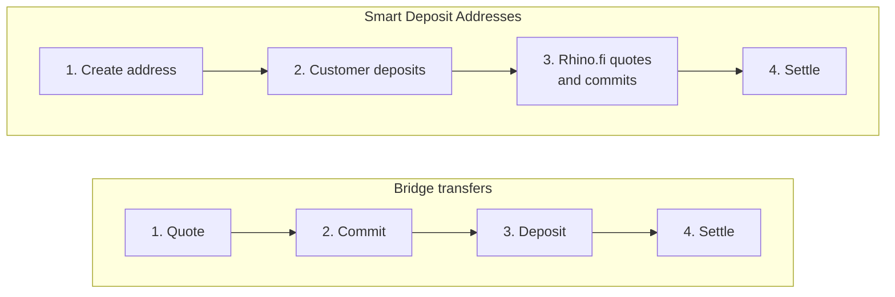

These conventions apply across the whole API, and the other guides in this section refer back to them.

## The quote ID

Every bridge, swap and SDA deposit is identified by one ID. Different endpoints call it by different names, but it is always the same value.

| Where you see it | Name | Notes |
| --- | --- | --- |
| Quote and commit responses | `quoteId` | Returned when you generate a quote, and again when you commit it |
| Bridge contract calls | `commitmentId` | The same hex string, passed as a `uint256`: `BigInt("0x" + quoteId)` |
| Status endpoint path | `bridgeId` | `GET /bridge/history/bridge/{bridgeId}` |
| Status and history responses | `_id` |  |

In these guides we call it the **quote ID** (`quoteId`), the name used in the quote and commit responses. Store it as soon as you receive it. It is the key for reconciliation, support requests and webhook matching.

## Chains and tokens

Chains are identified by uppercase names, such as `ETHEREUM`, `BASE`, `ARBITRUM` or `SOLANA`. Tokens are identified by their symbol, such as `USDT` or `USDC`. Don't hard-code these values. Read them from the [configs endpoint](/api-reference/bridge/configs/configs-chains-&-tokens), which needs no authentication:

```javascript
const configs = await rhinoFetch('/bridge/configs', { auth: false })
// configs.BASE.contractAddress, configs.BASE.tokens.USDC.decimals, ...
```

See the full list in [Supported chains and tokens](/get-started/supported-chains).

<Note>
  Addresses must use the format of the chain they belong to. For example, a Solana recipient needs a base58 address, not an EVM `0x…` address. Requests with a malformed address are rejected with a `422` error.
</Note>

## Amounts

The API expresses amounts as **decimal strings in whole token units**. For example, `"25.5"` means 25.5 USDC. Amounts are not in base units (wei, lamports and so on).

Smart contracts expect base units. Convert with the token's `decimals` from the configs endpoint, using an exact decimal library. Never use floating-point math:

```javascript
import { parseUnits } from 'ethers'

const baseUnits = parseUnits(quote.payAmount, configs.BASE.tokens.USDC.decimals)
```

## Quote lifecycle

Bridge transfers and swaps follow the same four steps:

1. **Quote.** You request a quote. It fixes the fees and amounts and returns an `expiresAt` timestamp.
2. **Commit.** You commit the quote before `expiresAt`. A quote that is not committed in time cannot be used.
3. **Deposit.** You send the onchain deposit that references the quote ID (`quoteId`), passed to the contract as `commitmentId`.
4. **Settle.** Rhino.fi detects the deposit and settles on the destination chain.

Smart Deposit Addresses follow their own four steps:

1. **Create.** You create an address for your end customer, with its destination chain, destination address and settlement token.
2. **Deposit.** Your customer, or your platform after consolidating funds, sends supported tokens to the address.
3. **Quote and commit.** Rhino.fi detects the deposit, then creates and commits a quote for it automatically.
4. **Settle.** Rhino.fi settles the funds on the destination chain.



## Errors

The API uses standard HTTP status codes. Error responses include a machine-readable error name. The `rhinoFetch` helper in [Authentication](/api-integration/authentication#keep-the-token-fresh) exposes it as `error.code`.

| Status | Meaning | What to do |
| --- | --- | --- |
| `400` | The request failed validation (`HttpApiDecodeError`) or the JWT is malformed (`InvalidJwt`) | Fix the request. For `InvalidJwt`, refresh the token. |
| `401` | Missing or expired credentials (`Unauthorized`) | Refresh the JWT and retry once |
| `403` | The feature is not enabled for your account (`ExtensionNotEnabled`), or the endpoint requires a secret key (`SecretApiKeyRequired`) | Contact your account manager, or call the endpoint from your backend with a JWT from a secret key |
| `404` | No route exists for this chain and token pair (`NoRouteFoundError`) | Offer a different pair |
| `422` | The request is valid but cannot be processed. See below. | Show the reason to the user, or adjust the amount |
| `429` | SDA creation limit reached (`DepositAddressRateLimitExceeded`) | Wait and retry, or ask your account manager to raise your limit |
| `503` | The endpoint is temporarily disabled (`EndpointDisabledError`) | Retry with exponential backoff |

Common `422` errors:

| Error | Cause |
| --- | --- |
| `DepositLimitReached`, `WithdrawLimitReached`, `SwapLimitReached` | The amount is outside the limits for this route |
| `NegativeReceiveAmount` | Fees exceed the amount being sent |
| `GasBoostGreaterThanReceiveAmount` | `amountNative` is larger than the amount received |
| `SameChainSwapNotAvailable` | Same-chain swaps are not available for this pair |
| `SdaDepositLimitExceeded`, `SdaDepositBelowMinimum` | The amount is outside the SDA deposit limits |
| `DepositAddressTokenOutNotSupported` | The requested `tokenOut` is not available on the destination chain |

Each endpoint lists its full set of errors in the [API reference](/api-reference/introduction).

## Pagination

List endpoints use cursor pagination. Pass `pageSize` (and `pageToken` for later pages). When more results exist, the response includes `nextPageToken`. Pass it back with the same filters to get the next page. When `nextPageToken` is absent, you have reached the last page.

```javascript
async function* paginate(path, params = {}) {
  let pageToken
  do {
    const query = new URLSearchParams({ ...params, ...(pageToken && { pageToken }) })
    const page = await rhinoFetch(`${path}?${query}`)
    yield* page.items
    pageToken = page.nextPageToken
  } while (pageToken)
}
```

## Limits

Limits depend on your account type. Trial accounts have fixed limits for testing and don't reflect production. Subscription accounts have production limits that depend on your plan.

| Limit | Trial | Subscription |
| --- | --- | --- |
| Smart Deposit Addresses, total | 500 | Up to 50,000 on Starter, higher on larger plans |
| SDA creation rate | Up to 50 per hour | Configured to your needs |
| Chains | EVM chains and Solana | All supported chains. Tron and Bitcoin through [Extensions](/get-started/extensions). |
| Extensions | Not available | Available per plan |
| Minimum and maximum deposit per token | Returned per token as `minDepositLimitUsd` and `maxDepositLimitUsd` | Same, set per route |

To change your limits or move to a subscription, contact your account manager. See [Trial accounts: what's included and how it differs from a subscription](https://learn.rhino.fi/articles/8966431786-trial-accounts-what-s-included-and-how-it-differs-from-a-subscription) and [Limits](/get-started/limits) for details.

You can check your current SDA creation usage with the [rate limit usage endpoint](/api-reference/sda/depositaddresses/obtain-the-current-rate-limit-usage-for-smart-deposit-address-creation).

## Fees

Fees depend on your account type.

- **Trial accounts** pay a fee per transaction, for testing purposes, deducted from the amount sent on the destination chain. Trial fees are not a guide to subscription pricing, and fee configuration is limited.
- **Subscription accounts** have most fees covered by the monthly subscription. Tron, Solana and Bitcoin have additional onchain costs (see [Tron, Solana and Bitcoin Access](/get-started/extensions/tron-access)). You choose who pays them: you or your end customer.

Every quote response includes the fees for that transaction in its `fees` breakdown. Your overall monthly usage is shown in the Rhino.fi Console and in the month-end invoice emailed to your organization. See [Fees](/get-started/fees-and-limits) for the commercial model.

## Next steps

<CardGroup cols={2}>
  <Card title="Smart Deposit Addresses" icon="inbox" href="/api-integration/smart-deposits">
    Give each customer a deposit address that settles automatically.
  </Card>

  <Card title="Bridge transfers" icon="arrow-right-arrow-left" href="/api-integration/bridge">
    Move and swap funds between chains from your own wallets.
  </Card>
</CardGroup>
