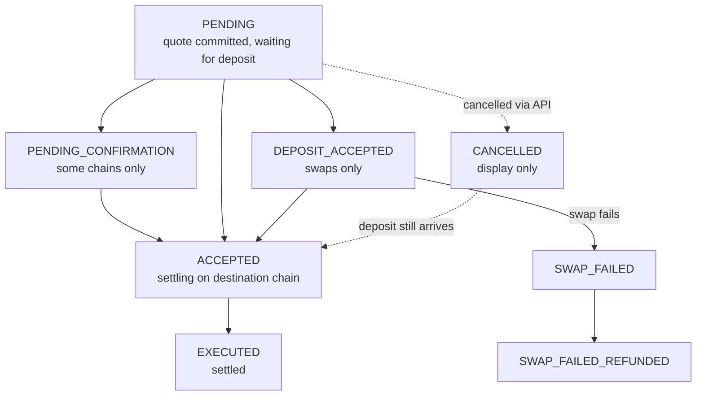

Every bridge transfer and SDA deposit moves through a defined set of states. You can follow them in two ways:

| Method | Best for | How |
| --- | --- | --- |
| **Webhooks** (recommended) | Production back-ends | Rhino.fi notifies your server at each state change |
| **Status endpoint** | Checking on demand, building UIs, recovering from missed events | `GET /bridge/history/bridge/{quoteId}` |

For reconciliation and reporting, use the history endpoint (see [List your transaction history](#list-your-transaction-history)).

## Receive webhooks

Register a webhook URL for your project in the Rhino.fi Console, under **Integrate → Webhooks**. Enter your base URL only: Rhino.fi adds `/rhinofi-event` to it. To override it for a single transfer or SDA, pass `webhookUrl` in the quote or SDA create request. Before you rely on webhooks in production:

1. [Set up your endpoint](/webhook/endpoint-setup).
2. [Verify every signature](/webhook/verify-webhook-signature). Reject any request that fails verification.
3. [Recover missed events](/webhook/get-missed-events) after downtime. From 9 November 2026, the event history endpoint requires a JWT from a secret key.

| Event | Sent when |
| --- | --- |
| `BRIDGE_PENDING` | A quote is committed. For SDAs, a deposit is detected. |
| `BRIDGE_ACCEPTED` | The deposit is received and validated |
| `BRIDGE_EXECUTED` | Funds are settled on the destination chain |
| `BRIDGE_REFUNDED` | A transfer with a swap is refunded, for example because of significant price movement. The status endpoint shows this as `SWAP_FAILED_REFUNDED`. |
| `BRIDGE_CANCELLED` | A committed transfer is cancelled |
| `DEPOSIT_ADDRESS_CREATED` | A new SDA is created |
| `DEPOSIT_ADDRESS_BRIDGE_REJECTED` | An SDA deposit is rejected, for example because the token is not supported |
| `DEPOSIT_ADDRESS_BRIDGE_DELAYED` | An SDA deposit is taking longer than expected |
| `SDA_REFUND_COMPLETED` | A refund from an SDA is completed |

See the [events list](/webhook/events-list) for payload details.

<Note>
  Webhook events and status-endpoint states don't always share a name. A refunded swap is `BRIDGE_REFUNDED` as a webhook event and `SWAP_FAILED_REFUNDED` as a state.
</Note>

## Check a transfer's status

```javascript
const transfer = await rhinoFetch(`/bridge/history/bridge/${quoteId}`)

console.log(transfer.state)          // e.g. "EXECUTED"
console.log(transfer.depositTxHash)  // present once the deposit is detected
console.log(transfer.withdrawTxHash) // present once settled
```

This endpoint requires authentication.

See the [API reference](/api-reference/bridge/history/obtain-the-status-of-a-specific-bridge-transaction) for the full response. You can also look a transfer up [by deposit hash](/api-reference/bridge/history/obtain-the-status-of-a-specific-bridge-transaction-by-deposit-hash) or [by withdrawal hash](/api-reference/bridge/history/obtain-the-status-of-a-specific-bridge-transaction-by-withdrawal-hash).

### States

A transfer normally moves `PENDING` → `ACCEPTED` → `EXECUTED`. Swaps and some fast chains add intermediate states.

| State | Meaning | Final? |
| --- | --- | --- |
| `PENDING` | The quote is committed. Rhino.fi is waiting for the deposit on the source chain. | No |
| `PENDING_CONFIRMATION` | The deposit is detected and waiting for network confirmations. Only some chains use this state. | No |
| `DEPOSIT_ACCEPTED` | Swaps only. The deposit is accepted and the source-chain swap is running. | No |
| `ACCEPTED` | The deposit is confirmed. Settlement on the destination chain is in progress. | No |
| `EXECUTED` | Funds are settled on the destination chain. | Yes |
| `CANCELLED` | A pending transfer was cancelled through the API. This state is display-only. If the deposit arrives later, the transfer still executes. | No |
| `SWAP_FAILED` | The swap failed. Rhino.fi reviews the transfer and refunds where applicable. | No |
| `SWAP_FAILED_REFUNDED` | The swap failed and the refund is complete. The matching webhook event is `BRIDGE_REFUNDED`. | Yes |
| `FAILED` | Rare. The transfer cannot be completed. Contact support to arrange a refund if one has not already been issued. | Yes |



{/* TODO(design): restyle this diagram in the new branding. TODO(eng): confirm where FAILED can occur. */}

<Note>
  `EXECUTED` is the only state that confirms settlement. We recommend crediting your customer's balance when you receive `BRIDGE_EXECUTED` or read `EXECUTED` from the status endpoint. Crediting earlier is possible, but it's a risk decision for your team.
</Note>

## List your transaction history

The history endpoint returns every transfer in your project, newest first. It requires a **secret key**, because it exposes your full history.

```javascript
const query = new URLSearchParams({
  pageSize: '20',
  sortBy: 'createdAt',
  sortDirection: 'desc',
})

let page = await rhinoFetch(`/history-cursor/user?${query}`)
console.log(page.items)

// Fetch the next page with the same parameters plus the token
while (page.nextPageToken) {
  query.set('pageToken', page.nextPageToken)
  page = await rhinoFetch(`/history-cursor/user?${query}`)
  console.log(page.items)
}
```

<Warning>
  The older page-and-limit history endpoint is deprecated and will be removed. Use the cursor endpoint above, which performs better on large histories.
</Warning>

For the history of a single SDA, see [List its deposits](/api-integration/smart-deposits#list-its-deposits).

## Next steps

<Card title="Go-live checklist" icon="list-check" href="/api-integration/go-live">
  Complete the security and operations checks before you launch.
</Card>
